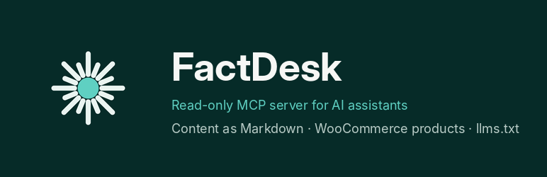

# FactDesk: read-only MCP server for WordPress



FactDesk adds a public, read-only [Model Context Protocol](https://modelcontextprotocol.io) (MCP) server to a WordPress site, so AI assistants and agents can search your content, read it as Markdown and look up WooCommerce products, prices and stock.

- **Install:** [FactDesk on WordPress.org](https://wordpress.org/plugins/factdesk/)
- **Documentation:** [313automations.com/blog/factdesk-wordpress-plugin](https://313automations.com/blog/factdesk-wordpress-plugin)
- **Built by:** [313 Automations](https://313automations.com), Lahore

There are no API keys to set up and nothing to pay for. The plugin makes no calls to outside services.

## What agents can do

- **Find out who you are.** Site name, description, language, main menu pages and the contact details you choose to share.
- **Search your content.** Pages, posts and any public custom post type you switch on, with a short summary of each match.
- **Read a page as Markdown.** The full text of any shared page or post, cleaned of menus and scripts, with headings, lists, tables and links kept.
- **List everything.** Every shared page and post, 50 at a time.
- **Search your shop (WooCommerce).** Find products by words, category, price range or stock.
- **Get product details (WooCommerce).** Price, sale price, availability, options and variations, description, rating and images, exactly as your shop shows them.

Agents can look, but they cannot change anything, place orders or send messages. Every tool is marked read-only.

## What is never shared

The server only shares what a logged-out visitor can already see on your site.

- Drafts, private, scheduled and password-protected content
- Anything marked noindex in Yoast SEO, Rank Math, SEOPress or The SEO Framework
- Products hidden from your shop catalogue
- Any page, post or product you hide with the "Hide from AI agents" box in the editor, or by ID in the settings

## Helping agents find you

- A server card at `/.well-known/mcp/server-card.json`, the file MCP directories and clients read to learn what your server offers.
- An `llms.txt` file listing your main pages, recent posts and product categories, with a pointer to the server. An existing llms.txt file is left alone.

## Installation

1. Install and activate FactDesk from **Plugins > Add New** (search for "FactDesk"), or download it from [WordPress.org](https://wordpress.org/plugins/factdesk/).
2. Go to **Settings > FactDesk**.
3. Choose what to share, add a sentence about your business, and save.
4. Click **Test the server**. When all three checks pass, copy the server address into any MCP client.

The server address is:

```
https://your-site.com/wp-json/factdesk/v1/mcp
```

With Composer:

```
composer require 313automations/factdesk
```

## Built to be safe

- Read-only by design: no tool writes, deletes or sends anything.
- A per-address rate limit (60 requests a minute by default).
- Requests over 64 KB and large batches are refused.
- Nothing leaves your site: no tracking, no remote calls, no account.

## For developers

Filters: `factdesk_post_available`, `factdesk_post_markdown`, `factdesk_tools`, `factdesk_call_tool`, `factdesk_site_info`, `factdesk_server_card`, `factdesk_llms_txt`, `factdesk_rate_limit` and `factdesk_client_ip`.

The server follows the MCP Streamable HTTP transport with plain JSON responses and no sessions, and supports protocol versions 2025-11-25, 2025-06-18, 2025-03-26 and 2024-11-05.

Requires WordPress 6.4 or later and PHP 7.4 or later.

## Support

- Questions and bug reports: [GitHub issues](https://github.com/313Automations/factdesk/issues) or the [WordPress.org support forum](https://wordpress.org/support/plugin/factdesk/)
- Every setting and tool is explained in the [FactDesk documentation](https://313automations.com/blog/factdesk-wordpress-plugin)

This repository mirrors the plugin released on WordPress.org. The WordPress.org version is the official release.

## License

GPL-2.0-or-later. See [LICENSE](LICENSE).
